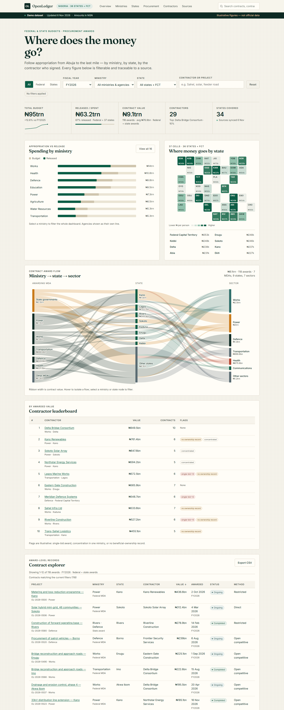
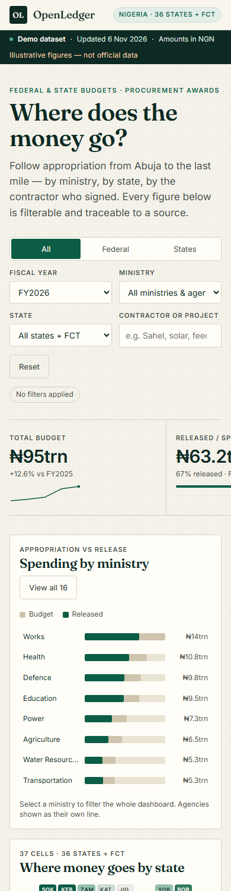

# OpenLedger

A working demo of a public budget and procurement transparency dashboard for Nigeria. It follows appropriation from the federal envelope and 36 state envelopes through to the ministries, states and contractors that receive awards.

**The dataset is illustrative, not official.** Ministry and agency names are real. Contractor names, projects, values and risk flags are generated from a fixed seed. Nothing here is an allegation about a real supplier.



## What it does

- **KPI band** — total envelope, released funds, award value, contractor count and states covered for the current selection.
- **Ministry bars** — appropriation against release for 16 federal ministries and agencies, with state envelopes apportioned across the same portfolio profile.
- **State cartogram** — all 37 jurisdictions in a fixed grid, shaded by state budget plus awards delivered in the state, per resident.
- **Award flow** — ministry or state government → state → sector, with ribbon width proportional to contract value. Nodes filter the dashboard.
- **Contractor leaderboard** — awarded value, award count and illustrative concentration / single-bid / ownership flags.
- **Contract explorer** — search, column sorting, pagination and CSV export across 590 award records for FY2022–FY2026.
- **Findings** — four computed cards for the selected envelope and award set.
- **Provenance** — source inventory, sync state, methodology notes and licence terms.

Filters compose: level, fiscal year, ministry, state and free-text query. Charts, tables and findings all respond to the same selection.

## Run it

No build step and no dependencies. Open `index.html` directly, or serve the folder:

```sh
npx serve .
```

Deploying to GitHub Pages: push the repository, then set **Settings → Pages → Deploy from a branch → main / (root)**. The app uses plain script globals rather than ES modules, so it also works from `file://`.

## Data and method

`data.js` generates the demo dataset in the browser from a fixed seed (`0x5eed2026`), so every load produces the same figures.

- Five fiscal years: 2022–2026.
- Federal and state envelope totals are shaped to published Nigerian budget scale, rising from ₦17.13trn federal in 2022 to ₦62.4trn in 2026.
- 590 awards, 118 per year, normalised to a procurement pool equal to 9.5% of the combined federal and state envelope.
- State budgets are split across the federal portfolio profile with per-state noise. That split is modelled, not published.
- Per-capita figures use 2022 population estimates for comparison only, not as an allocation formula.
- 58% of awards are federal MDA awards and 42% are state MDA awards. State awards are attributed to the delivering state and its sector ministry.
- Contractor identities are fictional. Risk flags are illustrative heuristics: a single-source or direct route, more than half of awards with no ownership record, or at least 65% of value concentrated in one ministry.

No network requests are made for data. Fonts load from Google Fonts with system fallbacks.

## Design

`DESIGN.md` is the design contract: warm paper, ink green, one amber accent, serif display type and tabular numerals. The CSS mirrors its tokens.

- Display: Fraunces. Body: Inter, with Segoe UI and system fallbacks.
- Palette: paper `#F7F4EC`, ink `#0E2A24`, primary `#0B5D45`, amber `#C97A1A`, coral `#B4432F`.
- No framework, no icon set, no charting library. Bars, cartogram, sparkline and flow diagram are hand-built SVG and CSS.

## Accessibility

- Skip link, landmark structure and labelled sections.
- Visible focus states, keyboard-operable bars, tiles, flow nodes and sortable headers.
- `aria-pressed` on filter controls, `aria-sort` on table headers, live filter summary.
- Drawer with modal semantics, Escape to close and a focus loop.
- AA contrast for text and controls; reduced-motion support.
- Charts carry text alternatives and every value is repeated in a table or label.

Small screens use horizontal scroll for the flow diagram and data tables rather than shrinking labels into illegibility.



## Project structure

```
index.html   page structure and accessible landmarks
styles.css   design tokens, layout, responsive states
app.js       filtering, aggregates, charts, tables, drawer, CSV
data.js      seeded demo dataset and provenance metadata
DESIGN.md    design contract (Google Labs DESIGN.md format)
docs/        screenshots
```

## Status and limitations

This is a portfolio demonstration, not a live transparency product. It does not fetch BudgIT, Open Treasury, NASS or state portal data at runtime, and it is not affiliated with any of those organisations. The provenance panel describes the sources the data model is shaped around. A production version would replace `data.js` with an ingestion layer, but the interface and design system would carry over.

## Licence

Code: MIT. Data: CC BY 4.0, illustrative only. See [LICENSE](LICENSE).
